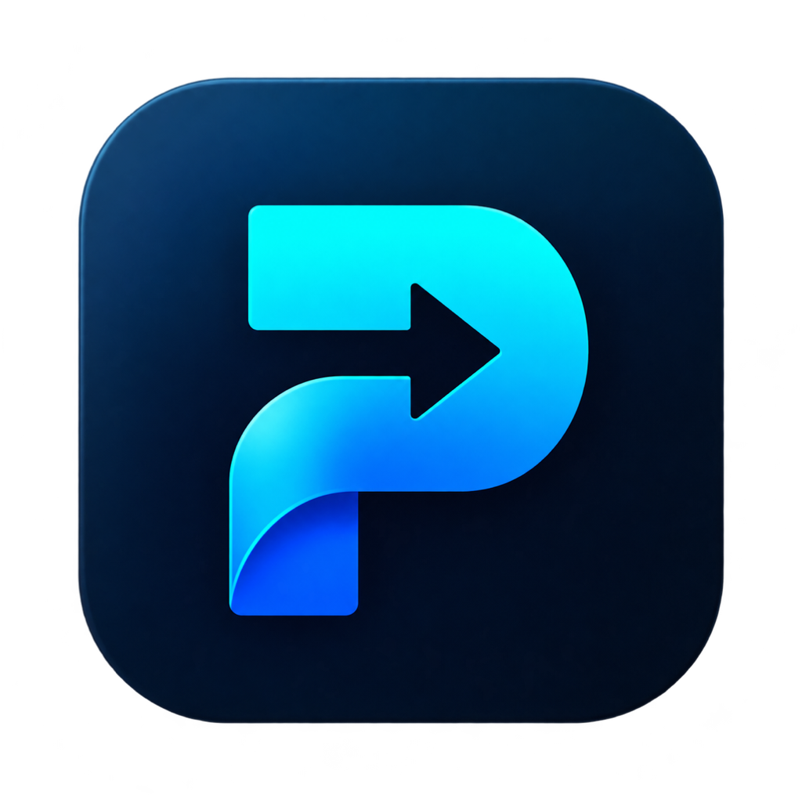
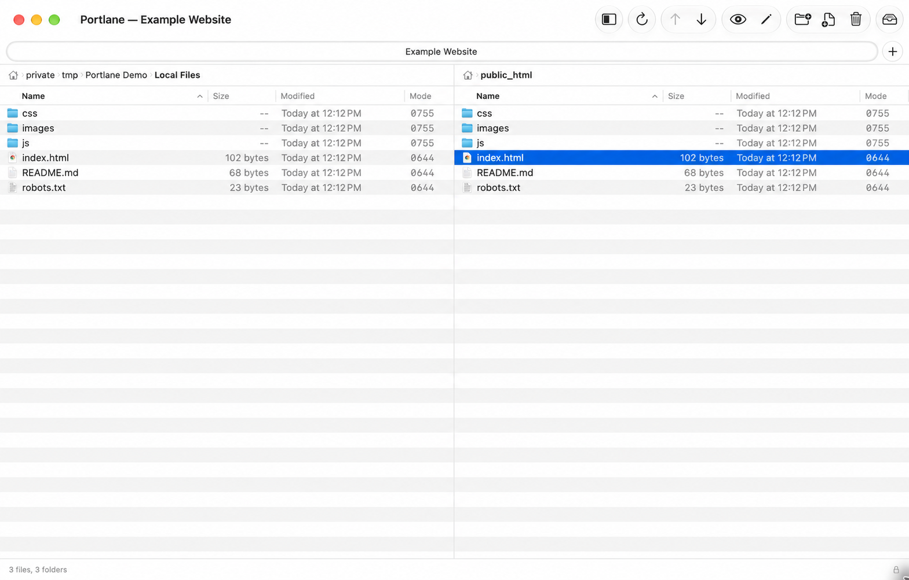

<h1> Portlane</h1>

[**Official website — portlane.app**](https://portlane.app/)

**A free, closed-source FTP, FTPES and SFTP client for macOS.**

Browse files on your Mac and server side by side, transfer them, and edit remote files in your preferred editor.

 

## Download

[**Download Portlane for macOS**](https://github.com/dimuchios84/portlane-releases/releases/download/v1.0.0-preview.1/Portlane-1.0.0-58-macOS-arm64-preview.dmg) · [Release notes and SHA-256](https://github.com/dimuchios84/portlane-releases/releases/tag/v1.0.0-preview.1)

**Portlane 1.0.0 · Build 58 · macOS 26+ · Apple Silicon (arm64)**

New installations start in **English**. Switch to Russian in **Portlane → Settings → General → Language**. This installer does not support Intel Macs or earlier macOS versions.

> **First-launch notice:** this build uses an Apple Development certificate. It is not signed with Developer ID and has not been notarized by Apple. macOS may block the first launch. See [Install and open](#install-and-open) below.

*The Portlane interface, shown with sample files and a demonstration connection.*

## What Portlane does

- Browse local and remote folders side by side.
- Connect using FTP, explicit TLS (FTPES), or SFTP over SSH.
- Upload and download files with a transfer queue.
- Open remote files in an external editor and upload saved changes.
- Create folders, rename, duplicate, and delete files.
- Store connection passwords in macOS Keychain.
- Use the interface in English or Russian.

## Made for everyday work

I built Portlane for my own work. I use it in my day-to-day work and test it myself. Your feedback helps me improve it.

## Support development

Portlane is free to use for personal and work purposes. Donations are entirely optional and are not required to unlock features or use the application.

If Portlane helps you, you can [support its development on Ko-fi](https://ko-fi.com/dimuchio) or [donate directly via PayPal](https://paypal.me/dimuchio). Thank you for helping keep the project moving forward.

A donation is voluntary support, not a purchase of distribution rights, ownership, a subscription, or a guarantee of future features or support.

## Install and open

1. Download the DMG using the official download link above.
2. Open the DMG and drag **Portlane** to **Applications**.
3. Read **Read Me First.txt** in the DMG, eject the disk image, and open Portlane from Applications.
4. If macOS blocks the app because its developer cannot be verified, and you trust this official download, open **System Settings → Privacy & Security** and choose **Open Anyway** for Portlane. Confirm the per-app prompt and try opening it again.

See [Apple's instructions for opening an app from an unidentified developer](https://support.apple.com/102445). Keep Gatekeeper enabled. Do not bypass warnings that say the app contains malware or is damaged. A managed Mac may restrict this option; contact its administrator if necessary.

## Usage terms

Portlane is proprietary software, not open source.

You may install and use official copies free of charge for your own personal or internal business purposes. You may not resell, redistribute, repackage, modify, or publish derivative versions without the copyright holder's prior written permission, except where applicable law or a third-party license grants rights that cannot be restricted.

Please share the [official repository link](https://github.com/dimuchios84/portlane-releases) instead of uploading copies elsewhere.

Read the full [Portlane Freeware License](LICENSE.md). Third-party components remain subject to their own licenses.

This repository contains public product information, usage terms, and official releases. It does **not** contain Portlane's application source code. GitHub's automatically generated “Source code” archives contain only this repository's public files; they are not the app or its source code.

## Feedback and support

Report bugs and suggest improvements through [GitHub Issues](https://github.com/dimuchios84/portlane-releases/issues).

Include your macOS version, Mac architecture, Portlane version, connection protocol, and steps to reproduce the issue. Remove passwords, private keys, access tokens, and other private information from logs and screenshots before posting.

---

Developed by [dimuchio](https://github.com/dimuchios84). [Ko-fi](https://ko-fi.com/dimuchio) · [PayPal](https://paypal.me/dimuchio).
